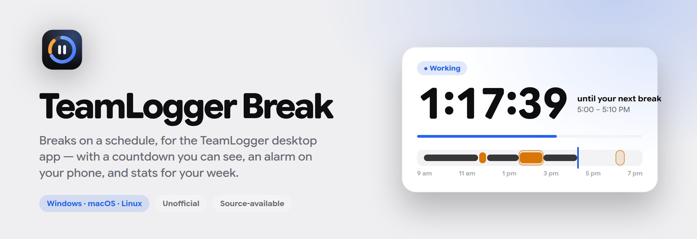
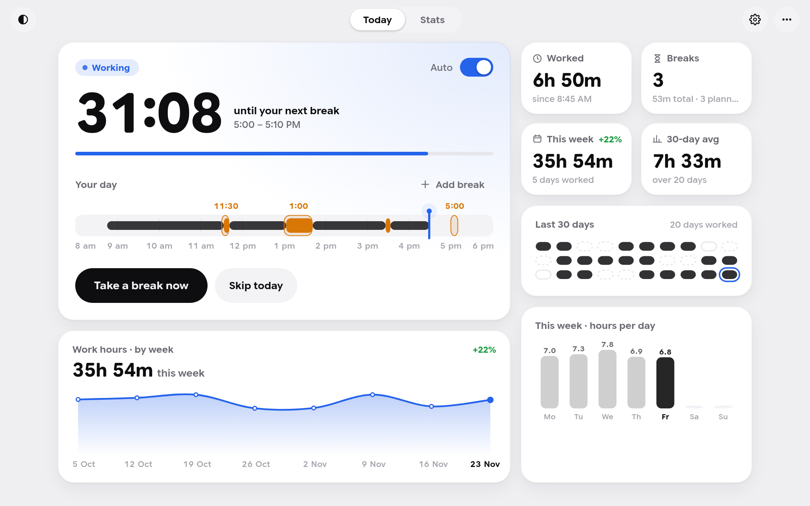
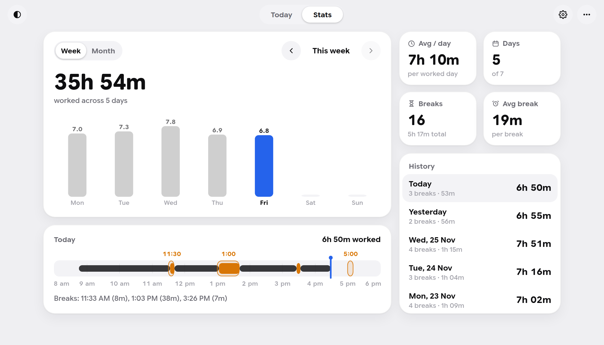
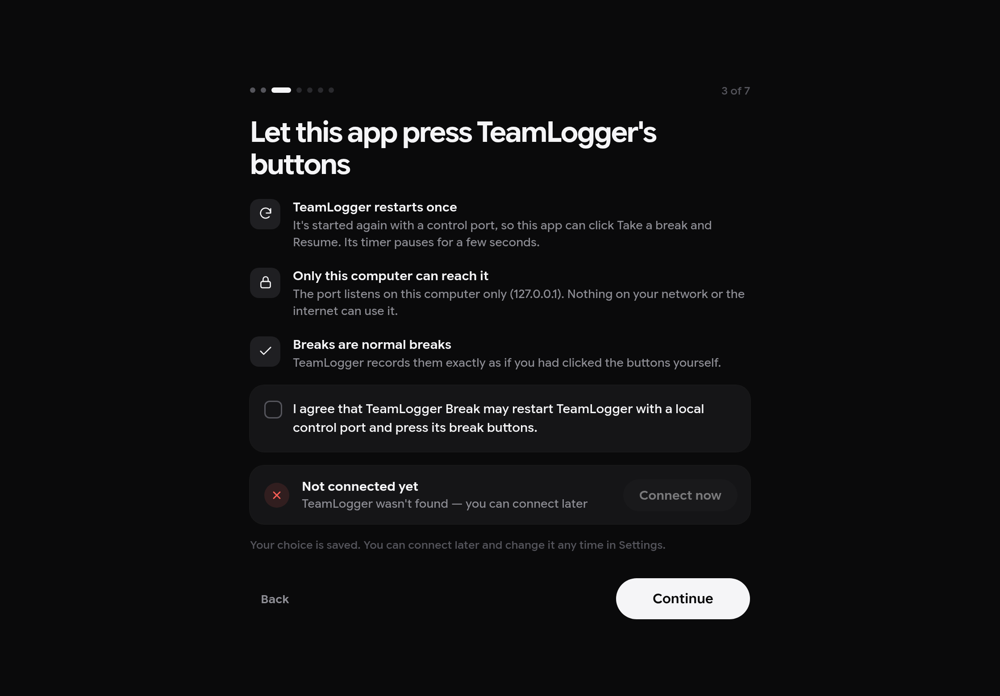

<picture>
  <source media="(prefers-color-scheme: dark)" srcset="docs/images/banner-dark.png">
  
</picture>

<p align="center">
  <b>Windows · macOS · Linux</b> &nbsp;·&nbsp; source-available &nbsp;·&nbsp; unofficial
</p>

---

**TeamLogger Break** takes your breaks for you. At the times you choose it presses **Take a break**
in the TeamLogger desktop app, counts down where you can see it, and presses **Resume** when the
break is over — so every break is recorded as a break, exactly as if you'd clicked yourself.

Step away from your desk and your phone still knows: a live countdown, a warning before the end,
and an alarm that rings until you're back. Back at your desk, your week is a glance away.

> Unofficial — not made by, endorsed by, or affiliated with TeamLogger.

<picture>
  <source media="(prefers-color-scheme: dark)" srcset="docs/images/today-dark.png">
  
</picture>

## What it does

**A countdown you can see**
The big number is the time to your next break — or, on a break, the time until you're back.
It's in the window, and in the menu bar / top bar / tray with a little ring that fills as the time passes.

**Your day on one line**
Work, breaks and planned breaks on a single strip, with a blue marker for *now*. Click a planned
break to change it; add one with **+ Add break**.

**Breaks that run themselves**
A 2-minute heads-up, then the break starts in TeamLogger on time. **+5 min** / **+10 min** to stretch it,
**Resume work** to come back early, **Skip today** when a meeting gets in the way.
Quitting the app never ends a break — it picks the break up again next time.

**An alarm on your phone**
Through the free [ntfy](https://ntfy.sh) app: a countdown that updates every minute, a warning a few
minutes before the end, and an alarm that repeats until you press **Stop**. The phone has buttons
too — **+5 min**, **+10 min**, **Resume now**. The alarm is scheduled on the ntfy server when the break
starts, so it still rings if your computer goes to sleep.

**Your week at a glance**
Worked time comes straight from TeamLogger's own "current working day" total. Week bars,
a month calendar, an 8-week trend, and every day's timeline and breaks.

<picture>
  <source media="(prefers-color-scheme: dark)" srcset="docs/images/stats-dark.png">
  
</picture>

**Light and dark**, following your system or your choice, set in **Google Sans Flex**.

## Install

You need the **TeamLogger desktop app** installed and signed in on the same computer. Then download
the installer for your system from **[Releases](../../releases)** (open **Assets** under the latest release):

| System | Download | Then |
|---|---|---|
| **Windows** | `TeamLogger Break_…_x64-setup.exe` (or `.msi`) | Run it. If SmartScreen warns, click **More info → Run anyway** (the installer isn't signed yet). |
| **macOS** | `TeamLogger Break_…_universal.dmg` | Drag the app to **Applications**. First launch: **right-click → Open → Open** (not notarized yet). |
| **Ubuntu / Debian** | `TeamLogger Break_…_amd64.deb` | `sudo apt install ./TeamLogger*Break_*_amd64.deb` |
| **Fedora / openSUSE** | `TeamLogger Break-….x86_64.rpm` | `sudo dnf install ./TeamLogger*Break-*.rpm` |
| **Any Linux** | `TeamLogger Break_…_amd64.AppImage` | `chmod +x` it, then run it |

On Linux the countdown sits in the top bar; GNOME needs the *AppIndicator* extension
(built into Ubuntu). Building from source and uninstalling: see the **[user guide](docs/USER_GUIDE.md)**.

## Getting started

1. **Open TeamLogger Break** and follow the setup — seven short steps the first time:

   

   | | |
   |---|---|
   | **Find TeamLogger** | found automatically, or choose it with *Browse…* |
   | **Permission** | agree that the app may restart TeamLogger once with a local control port, then **Connect** |
   | **Notifications & sound** | allow notifications, try the alarm |
   | **Your breaks** | start from a suggested schedule (11:30 · 10m, 1:00 · 40m, 5:00 · 10m) and pick your days |
   | **Phone** *(optional)* | scan the QR code in ntfy, send a test |
   | **Almost done** | start at login, light or dark |

2. **That's it.** Close the window — it keeps running in the menu bar / tray. Your breaks happen on time.

Want to try it without anything happening in TeamLogger first? Turn on **Test mode** in
Settings → General — everything runs, nothing is clicked.

## Using it

- **The big number** is the time to your next break — or, on a break, until you're back.
- **Take a break now** starts one straight away; during a break, **Resume work** ends it early and
  **+5 min** / **+10 min** stretches it. **Skip today** skips the rest of today's breaks.
- **Your day** shows work, breaks and planned breaks; **click a planned break to change it**, or **+ Add break**.
- **Auto** turns automatic breaks on or off. **Stats** (top) shows your week and month.
- **Close the window** and it keeps running — the ring and countdown in the menu bar / tray has
  *Open*, *Automatic breaks*, *Skip today* and *Quit*.
- **After each login**, TeamLogger starts without the control port: if you see **Connect TeamLogger**,
  click it once (TeamLogger restarts for a few seconds).
- **Phone alerts:** install the free **ntfy** app, then Settings → Phone & alarm → *Set up your phone*,
  scan the QR code and press **Send test**.

Everything in detail — settings, phone alarm on Android/iPhone, troubleshooting, uninstalling —
is in the **[user guide](docs/USER_GUIDE.md)**.

## How it works

TeamLogger is an Electron app. When you press **Connect**, TeamLogger Break restarts it once with
`--remote-debugging-port=9333` — a control port that listens on **this computer only** (127.0.0.1).
Through it, the app reads TeamLogger's window (are you working or on a break, how long you've worked
today) and presses its buttons, finding them by their visible text.

```
 schedule ──► scheduler (every second) ──► TeamLogger "Take a break" / "Resume"   (127.0.0.1 only)
                     │
                     ├──► notifications + sound on this computer
                     └──► ntfy ──► your phone: countdown · warning · alarm · buttons
```

On Linux (GNOME) TeamLogger is restarted in its own app scope, so its screenshot permission is unchanged.

## Safety and privacy

- **Local only.** The control port is reachable from this computer only; the app refuses any other address.
- **Your consent first.** Nothing is restarted or clicked until you agree in setup.
- **Real breaks.** TeamLogger records them exactly as if you'd clicked the buttons yourself.
- **Test mode** (Settings → General) runs the whole schedule — notifications, phone, countdown — without
  clicking anything in TeamLogger.
- **Your data stays here.** Schedule, timeline and stats live on your computer. Only if you turn on phone
  alerts are break times sent to ntfy — keep your topic private; anyone who knows it could see your breaks.

## Status

| | |
|---|---|
| **Linux** | complete and tested |
| **Windows, macOS** | built and unit-tested by CI; starting/stopping TeamLogger is written but **not yet verified on real machines** — reports welcome |
| **Signing** | installers are unsigned for now (macOS: right-click → Open the first time; Windows: *More info → Run anyway*) |

## For developers

```
app/                  the app — Tauri v2 (Rust core + TypeScript UI)
  src-tauri/src/        schedule · runtime · control (TeamLogger) · cdp · launch · phone · sound · tray · store · activity
  src/                  Today · Stats · Settings · Setup, design system in styles.css
*.py                  the original Linux (GNOME) app — Python + GTK 4 / libadwaita
docs/                 plan, handoff notes, releasing
.github/workflows/    CI on all three systems; release builds on tags
```

```bash
cd app
npm ci
npm run dev              # the UI in a browser, with demo data
npx tauri dev            # the desktop app
cd src-tauri && cargo test
```

Development builds **never click TeamLogger** unless `TLB_ALLOW_CLICKS=1` is set — see
[docs/HANDOFF.md](docs/HANDOFF.md) for the mock-page tests. Releasing: [docs/RELEASING.md](docs/RELEASING.md).

## License

**Source-available, not open source** — [PolyForm Internal Use License 1.0.0](LICENSE.md).
You may use TeamLogger Break, including at work, and change it for your own internal use.
You may not redistribute it or modified versions.

Typeface: Google Sans Flex, SIL Open Font License 1.1 — [`fonts/OFL.txt`](fonts/OFL.txt).
"TeamLogger" is a trademark of its owner; this project is not affiliated with it.
